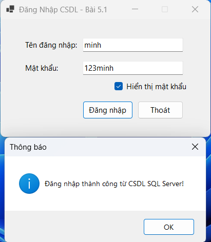
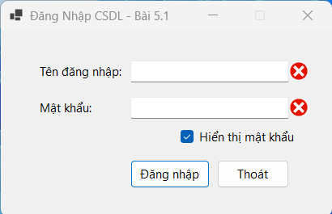
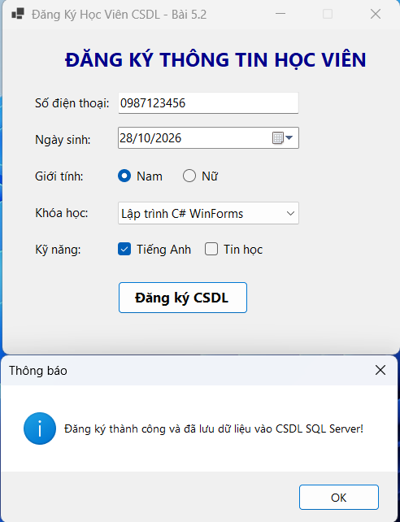
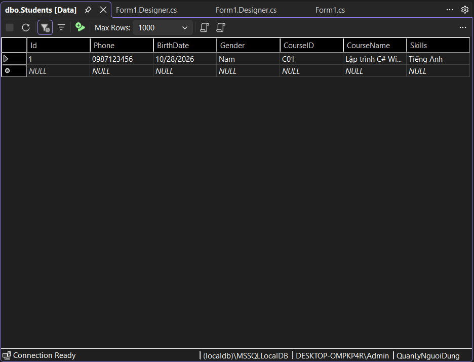

# BÁO CÁO BÀI TẬP THỰC HÀNH LẬP TRÌNH C# WINFORMS

## I. THÔNG TIN SINH VIÊN
- **Họ và tên:** Nguyễn Vũ Nhật Minh
- **Mã số sinh viên:** 24810320314
- **Lớp học phần:** Lập trình .NET - Mã Lớp: 010100475509
- **Link Repository:** https://github.com/minhnvn24810320314/LTNET-BAI5_24810320314_NguyenVuNhatMinh.git

---

## II. DANH SÁCH BÀI TẬP HOÀN THÀNH & TỰ ĐÁNH GIÁ

| Bài tập | Tiêu đề bài tập | Trạng thái | Mức độ hoàn thành (%) |
| :---: | :--- | :---: | :---: |
| **Bài 5.1** | Nâng cấp Bài 4.1 - Đăng nhập kết nối SQL Server CSDL | Hoàn thành | 100% |
| **Bài 5.2** | Nâng cấp Bài 4.2 - Đăng ký học viên lưu dữ liệu SQL Server | Hoàn thành | 100% |

---

## III. MINH HỌA GIAO DIỆN & KỸ THUẬT NỔI BẬT

### 1. Bài 5.1: Nâng cấp Form Đăng Nhập Kết Nối CSDL SQL Server
- **Kỹ thuật áp dụng:** Thư viện `Microsoft.Data.SqlClient`, kết nối SQL Server LocalDB (`QuanLyNguoiDung`), truy vấn an toàn bằng `SqlCommand` kết hợp `Parameters` chống SQL Injection, cảnh báo bằng `ErrorProvider`.
- **Hình ảnh minh họa Giao diện:**

*Mô tả: Đăng nhập thành công sau khi kiểm tra và xác thực tài khoản lưu trữ trong bảng Users.*

*Mô tả: Kiểm tra hợp lệ bằng ErrorProvider hiển thị cảnh báo đỏ khi người dùng để trống thông tin.*

---

### 2. Bài 5.2: Nâng cấp Form Đăng Ký Học Viên Lưu Dữ Liệu SQL Server
- **Kỹ thuật áp dụng:** Thực thi truy vấn `INSERT INTO` thông qua `SqlCommand` với đầy đủ tham số, lưu trữ thông tin đăng ký học viên trực tiếp xuống CSDL, xử lý ngoại lệ kết nối bằng khối `try-catch`.
- **Hình ảnh minh họa Giao diện:**

*Mô tả: Điền đầy đủ thông tin học viên và nhấn Đăng ký thành công lưu dữ liệu vào CSDL.*

*Mô tả: Dữ liệu thực tế được lưu trữ chính xác trong bảng Students của SQL Server (Show Table Data).*

---